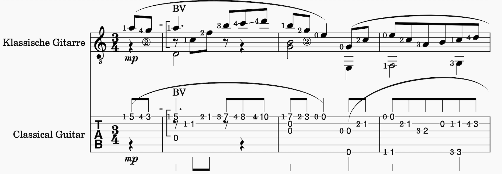
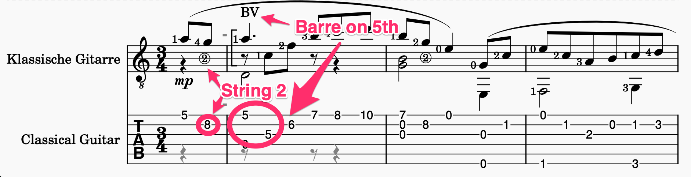
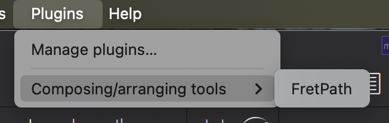
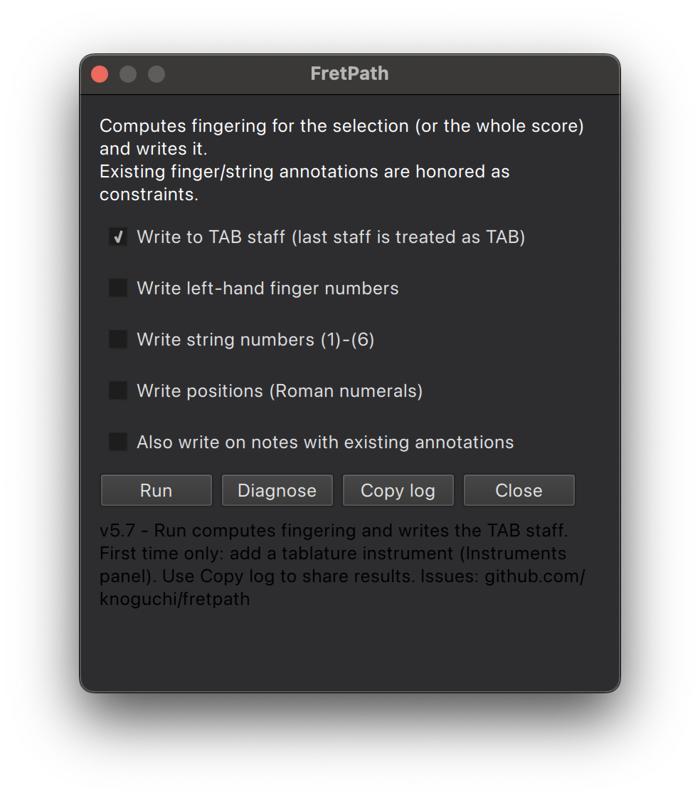

# FretPath

Playable guitar fingering for MuseScore Studio 4.4+.

Repository: https://github.com/knoguchi/fretpath
Bug reports and feature requests: https://github.com/knoguchi/fretpath/issues

Computes playable guitar fingering - (string, fret, left-hand finger,
position) for every note - using position-aware Viterbi dynamic programming,
and writes a TAB staff and/or annotations.

Unlike MuseScore's built-in conversion (StringData::convertPitch, a per-note
greedy scan that picks the thinnest string with the lowest fret), this plugin
optimizes the whole sequence: it minimizes hand movement along the neck,
prefers open strings, penalizes wide chord stretches, and respects existing
finger-number and string-number annotations as hard constraints. Alternate
tunings (drop D etc.) and fret counts are read automatically from the
instrument's string data.

## Comparison

Same excerpt, same notation — only the TAB staff differs.

MuseScore built-in (per-note greedy):

FretPath (position-aware Viterbi):

The built-in conversion picks the thinnest available string for each note in
isolation, producing frets up to 10 and a hand that jumps around the neck.
FretPath uses open strings where they fit, spreads the line across the
fretboard, and stays in low positions — the way a classical guitarist would
actually play it.

## Setup
1. Copy this folder to Documents/MuseScore4/Plugins and restart MuseScore.
2. Enable the plugin in Home > Plugins.
3. First time only: open the Instruments panel (I), search "tablature",
   and add "Classical Guitar (tablature)". The plugin treats the last
   staff as the TAB target.

## Usage

Launch from **Plugins → Composing/arranging tools → FretPath**:

The plugin dialog:

The top line names what will be processed: the selection's first staff,
or staff 1 when nothing is selected, and the TAB staff (the last staff).

- **Run** — computes the fingering and writes it. Re-running replaces what
  the plugin wrote before; your own annotations are kept.
- **Clear** — removes the plugin's annotations from the selection (or the
  whole staff).
- **TAB staff** — copies the notes to the last staff and sets each note's
  string and fret, in the same color as the annotations. Off: annotations
  only.
- **Finger numbers / Positions (I, II, III...)** — optional annotations on
  the source staff.
- **String numbers** — *Off* (default), *Always* (every fretted note), or
  *When the string changes*: only the melody (the top note of each chord)
  is marked, where its string differs from the previous melody note's.
  Inner chord notes and open strings are never marked. Written in
  MuseScore's String Number style, so they are drawn circled and read back
  as constraints.
- **Color new marks blue** — plugin annotations are blue (#0065bf), or a
  near-black #010101 when unchecked. Either way the plugin recognizes them
  as its own: every annotation it writes is also recorded in a score meta
  tag (`fretPath`). One you edit by hand is no longer the plugin's: it is
  recolored black and honored as a constraint.
- **Replace my own fingerings** — off by default: finger and string
  numbers you wrote are kept and used as constraints. On: they are
  replaced too.
- **Copy** — copies the status text for bug reports (and saves it to a
  file, since the clipboard does not take it on every platform). If no
  fingering is found, the status includes a diagnosis to send along.

## How it works
1. All four voices of the source staff are collected and merged into
   onset events; existing annotations become constraints.
2. Viterbi over states (fingering combo, hand position) finds the
   globally cheapest fingering. Cost terms: position-shift distance and
   count, quadratic penalty past the body joint, chord stretch, open
   string bonus, and deviation from annotated fingers.
3. The score is replicated to the TAB staff via MuseScore's own copy &
   paste (faithful voices, durations, ties); if paste is unavailable the
   plugin falls back to note-by-note entry.
4. Each note's string/fret is overwritten with the Viterbi result, stems
   are removed, rests hidden. A final pass re-reads the TAB staff and
   verifies that every collected note is present.

## Known limitations
- The TAB instrument must be added manually once: MuseScore's appendPart
  API does not apply tablature staff types (engraving/dom/score.cpp:4376
  copies only the line count from the instrument template).
- Chords whose annotations cannot be satisfied (e.g. natural harmonics)
  are skipped and reported.
- Requires MuseScore Studio 4.4 or later.

## License
GPL-3.0. Copyright (C) 2026 Kenji Noguchi <tokyo246@gmail.com>.
